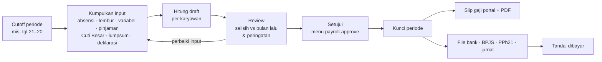
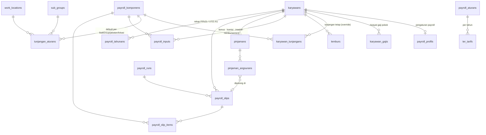
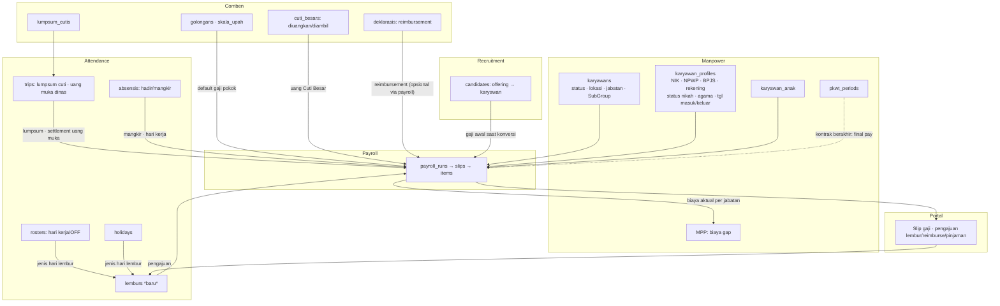

# Rencana Modul Payroll — Eolas HRIS

> Status: **fase 1 sebagian dibangun** (lihat bagian 12) · disusun 24 Okt 2026, diperbarui 25 Okt 2026 · basis kode: branch `eloas`
> Acuan regulasi: PP 58/2023 & PMK 168/2023 (PPh21 TER), UU HPP (tarif Pasal 17), PP 35/2021 (lembur),
> Permenaker 6/2016 (THR), Perpres 64/2020 (BPJS Kesehatan), PP 44/2015 & PP 45/2015 (BPJS Ketenagakerjaan).
> Semua angka tarif dan batas disimpan sebagai **master data per tahun**, bukan ditanam di kode.

---

## 1. Tujuan

Menghitung gaji bulanan, THR, dan pembayaran lainnya untuk setiap karyawan, langsung dari data yang sudah ada di Eolas. Data itu meliputi profil, status PTKP, absensi, cuti, dinas, dan deklarasi. Hasilnya:

- slip gaji di portal karyawan;
- file transfer bank;
- laporan BPJS dan PPh21 (termasuk 1721-A1 akhir tahun);
- jurnal untuk keuangan.

Semua tahapnya punya alur persetujuan dan jejak audit.

## 2. Komponen payroll (dari kebutuhan)

| Komponen | Jenis | Sumber data | Kena PPh21 | Dasar BPJS | Dasar THR |
|---|---|---|---|---|---|
| Gaji Pokok | Pendapatan tetap | Riwayat gaji karyawan (default dari Skala Upah) | ✔ | ✔ | ✔ |
| Tunjangan Tetap (jabatan, transport, komunikasi, perumahan) | Pendapatan tetap | Aturan tunjangan per SubGroup/jabatan/lokasi + override per karyawan | ✔ | ✔ (bisa diatur per komponen) | ✔ |
| Tunjangan Tidak Tetap (lembur, shift, bonus, insentif) | Pendapatan variabel | Lembur (Attendance), roster shift, input variabel | ✔ | ✘ | ✘ |
| BPJS Kesehatan | Iuran | Aturan tahunan: 4% perusahaan + 1% karyawan, dasar dibatasi plafon | Bagian perusahaan = penghasilan | — | — |
| BPJS Ketenagakerjaan (JKK, JKM, JHT, JP) | Iuran | Aturan tahunan; JKK sesuai kelas risiko lokasi kerja | JKK+JKM perusahaan = penghasilan; JHT 2% + JP 1% karyawan = pengurang | — | — |
| PPh21 | Potongan / tunjangan | Mesin pajak: TER (Jan–Nov), Pasal 17 (Des/keluar); biaya jabatan; PTKP; gross / gross-up / net | — | — | — |
| Pinjaman | Potongan | Pinjaman karyawan + jadwal angsuran | ✘ | ✘ | ✘ |
| THR | Pendapatan tidak teratur | Run THR, proporsional masa kerja | ✔ (TER bulan dibayar) | ✘ | — |

Fitur pendukung:
- **Overtime:** lembur → slip, memakai kalender kerja dari roster dan hari libur.
- **Variable inputs:** bonus, komisi, reimbursement, dengan alur persetujuan.
- **THR batch:** perhitungan THR dan slip THR untuk banyak karyawan sekaligus.

## 3. Aturan perhitungan

### 3.1 BPJS
| Program | Perusahaan | Karyawan | Dasar upah |
|---|---|---|---|
| Kesehatan | 4% | 1% | Gaji pokok + tunjangan tetap; minimum UMK lokasi, maksimum plafon (saat ini Rp12.000.000) |
| JKK | 0,24 / 0,54 / 0,89 / 1,27 / 1,74% | — | Kelas risiko per **lokasi kerja** (site tambang ≠ Head Office) |
| JKM | 0,30% | — | Upah |
| JHT | 3,70% | 2% | Upah |
| JP | 2% | 1% | Upah, maksimum plafon JP (diperbarui setiap tahun) |

- Persentase, plafon, dan UMK disimpan di tabel `payroll_aturans` per tahun.
- Kepesertaan per karyawan (ikut/tidak, jumlah anggota keluarga tambahan BPJS Kes) disimpan di `payroll_profils`.

### 3.2 PPh21
- **PTKP (keputusan):** otomatis, tanpa override, oleh `App\Support\Payroll\Ptkp`.
  - Pria: K atau TK sesuai status nikah, tanggungan = jumlah anak, maksimal 3 (menikah dengan 4 anak = K/3).
  - Wanita: selalu TK/0, walaupun menikah dan punya anak.
  - Benefit seperti plafon pengobatan tetap mengikuti status nikah di data karyawan (`Entitlement`).
- **Kategori TER:** A = TK/0, TK/1, K/0; B = TK/2, TK/3, K/1, K/2; C = K/3.
- **Januari–November:** PPh21 = tarif TER bulanan × penghasilan bruto bulan itu. Bruto termasuk iuran BPJS yang dibayar perusahaan (JKK, JKM, BPJS Kes perusahaan).
- **Desember, atau bulan terakhir bagi karyawan yang keluar:** hitung setahun.
  - Bruto setahun dikurangi biaya jabatan (5%, maksimal Rp500.000/bulan atau Rp6.000.000/tahun), JHT dan JP karyawan, lalu PTKP. Hasilnya penghasilan kena pajak (PKP), dibulatkan ke ribuan.
  - Tarif Pasal 17: 5% (s.d. 60 jt), 15% (s.d. 250 jt), 25% (s.d. 500 jt), 30% (s.d. 5 M), 35% (di atas 5 M).
  - PPh Desember = PPh setahun − total yang sudah dipotong Januari–November.
- **Metode per karyawan:**
  - *Gross* — dipotong dari gaji.
  - *Gross-up* — tunjangan pajak dihitung iteratif sampai tunjangan = PPh.
  - *Net* — ditanggung perusahaan, tidak menjadi penghasilan.
- **Tanpa NPWP/NIK valid:** tarif 20% lebih tinggi. NIK di profil sudah ada; tambah flag validasi.

### 3.3 Lembur (PP 35/2021)
- Upah per jam = 1/173 × (gaji pokok + tunjangan tetap).
- **Hari kerja:** jam ke-1 × 1,5, jam berikutnya × 2.
- **Hari istirahat atau libur:** tarifnya mengikuti pola 5 atau 6 hari kerja.
  - Pola 6 hari kerja (umum di site): jam ke-1–7 × 2, jam ke-8 × 3, jam ke-9 dst × 4.
  - Pola 5 hari kerja: jam ke-1–8 × 2, jam ke-9 × 3, jam ke-10 dst × 4.
- **Status hari diambil otomatis:** OFF di **roster** = hari istirahat; tanggal di tabel **holidays** = hari libur nasional.
- **Pengecualian:** karyawan Staff atau jabatan tertentu bisa ditandai tidak berhak lembur; untuk mereka dipakai tunjangan lembur tetap atau tidak ada lembur sama sekali (flag di `payroll_profils`).

### 3.4 Pro-rata, mangkir, keluar-masuk
- Karyawan masuk atau keluar di tengah periode dibayar pro-rata hari kalender (bisa diganti hari kerja dari roster). Datanya dari `tanggal_masuk` dan `tanggal_keluar`.
- Hari mangkir (kode absensi `A`) mengurangi upah sebesar 1/hari kerja per hari, jika diaktifkan di aturan.
- Karyawan keluar mendapat **final pay**: sisa gaji, PPh dihitung setahun di bulan itu, dan pelunasan sisa pinjaman.

### 3.5 THR (Permenaker 6/2016)
- Masa kerja ≥ 12 bulan: 1 × (gaji pokok + tunjangan tetap).
- Masa kerja 1–12 bulan: masa kerja / 12 × upah.
- Hari raya mengikuti **agama** di profil (Idulfitri, Natal, Nyepi, Waisak, Imlek). Tiap run THR dibuat per hari raya dan dibayar paling lambat H-7.
- Pajaknya TER bulan dibayar, dihitung atas gabungan gaji + THR.

### 3.6 Pinjaman
- Data pinjaman: pokok, tenor, angsuran per bulan, dan periode mulai. Angsuran dipotong otomatis di setiap run.
- Pinjaman bisa dilunasi lebih cepat atau ditunda satu periode (dengan persetujuan).
- Batas potongan, misalnya maksimal 50% dari gaji bersih, divalidasi saat pinjaman dibuat.

## 4. Alur kerja bulanan

- Status run: `draft → dihitung → diajukan → disetujui → dibayar → terkunci`.
- Run yang sudah terkunci tidak bisa diubah. Koreksi masuk sebagai **penyesuaian** (komponen `koreksi`) di periode berikutnya.
- Satu run boleh mencakup **semua lokasi** atau **satu lokasi kerja**, mengikuti `AccessScope`, karena payroll site dan Head Office sering diproses terpisah.
- Jenis run: `reguler`, `thr`, `bonus` (misalnya bonus tahunan), `final` (karyawan keluar).

## 5. Model data baru

| Tabel | Isi utama |
|---|---|
| `payroll_komponens` | kode, nama, jenis (`pendapatan`/`potongan`/`iuran_perusahaan`), sifat (`tetap`/`tidak_tetap`/`tidak_teratur`), flag `kena_pajak`, `dasar_bpjs`, `dasar_thr`, `prorata`, `sumber` (`manual`/`otomatis`), urutan tampil di slip |
| `karyawan_gajis` | karyawan, `berlaku_mulai`, gaji_pokok, golongan & step Skala Upah (opsional), alasan (masuk/kenaikan/promosi), dibuat_oleh. **Riwayat, tidak ditimpa.** |
| `tunjangan_aturans` | komponen, SubGroup / jabatan / lokasi kerja / klasifikasi, nominal atau % gaji pokok, tahun berlaku |
| `karyawan_tunjangans` | override tunjangan tetap per karyawan, `berlaku_mulai`, `berlaku_sampai` |
| `payroll_profils` | metode pajak (gross/gross-up/net), PTKP override, NPWP valid, kepesertaan BPJS, anggota BPJS Kes tambahan, berhak lembur, pola hari kerja (5/6), rekening tujuan (default dari profil) |
| `payroll_aturans` | per tahun: tarif & plafon BPJS, UMK per lokasi, nilai PTKP, biaya jabatan, cutoff periode, kebijakan mangkir/pro-rata |
| `ter_tarifs` | kategori A/B/C, batas bawah, batas atas, tarif (seed dari lampiran PP 58/2023) |
| `jkk_kelas` | kelas risiko JKK per lokasi kerja |
| `lemburs` | karyawan, tanggal, jam mulai–selesai, jumlah jam, jenis hari (otomatis), alasan, status (`diajukan`/`disetujui`/`ditolak`), sumber (`portal`/`hr`/`import`), `verified_by` |
| `payroll_inputs` | karyawan, periode, komponen, nominal, keterangan, lampiran, status persetujuan, sumber, ref (mis. `deklarasi:123`) |
| `pinjamans` / `pinjaman_angsurans` | pokok, tenor, angsuran, mulai periode, status; angsuran per periode → slip yang memotongnya |
| `payroll_runs` | periode (`2026-11`), jenis, lokasi (nullable = semua), tanggal cutoff, tanggal bayar, status, dihitung/disetujui/dikunci oleh & kapan |
| `payroll_slips` | run, karyawan, **snapshot** (jabatan, lokasi, PTKP, kategori TER, NPWP, rekening, hari kerja), bruto, potongan, PPh21, take home pay, iuran perusahaan |
| `payroll_slip_items` | slip, komponen, nama (snapshot), nominal, kena pajak, sumber ref (lembur/input/deklarasi/trip/angsuran) |
| `payroll_tahunans` | karyawan, tahun, bruto setahun, pengurang, PKP, PPh terutang, sudah dipotong, untuk 1721-A1 |

**Kenapa snapshot:** slip yang sudah dibayar tidak boleh berubah walaupun profil, jabatan, atau aturan diubah setelahnya.

## 6. Relasi dengan modul lain

| Modul | Data yang dipakai payroll | Arah | Catatan implementasi |
|---|---|---|---|
| **Manpower – Karyawan** | status, lokasi kerja, jabatan, SubGroup, tanggal masuk/keluar | baca | Karyawan aktif dalam periode memakai logika seperti `App\Support\Attendance\Roll` |
| **Manpower – Profil** | NIK, NPWP, no. BPJS TK/Kes, rekening & bank, status nikah, agama, klasifikasi, status pegawai | baca + snapshot | PTKP dari `Entitlement::statusPtkp()`; agama untuk hari raya THR |
| **Manpower – Anak** | jumlah tanggungan | baca | PTKP (maks 3) & anggota BPJS Kes |
| **Manpower – PKWT / Keluar** | tanggal berakhir kontrak, `tanggal_keluar` | baca → memicu | Run `final`: pro-rata, PPh setahun, pelunasan pinjaman |
| **Manpower – MPP** | — | payroll → MPP | Estimasi biaya gap dari biaya aktual (bukan hanya Skala Upah, `Mpp::upah`) |
| **Comben – Skala Upah & Golongan** | nominal per golongan/step/lokasi/tahun | baca | Default `karyawan_gajis` saat karyawan baru atau naik golongan |
| **Comben – Cuti Besar** | keputusan `diuangkan` (2× gapok) / `diambil` (+1× gapok) | baca → input | Otomatis menjadi `payroll_inputs` setelah disetujui; nilai dari `cuti_aturans` |
| **Comben – Deklarasi** | deklarasi disetujui per bulan buku | baca → input (opsional) | Jika reimbursement dibayar lewat gaji: dibuat `payroll_inputs` tidak kena pajak dengan ref `deklarasi:id`; bulan buku (`BukuBulan`, tutup tgl 8) diselaraskan dengan cutoff payroll |
| **Attendance – Absensi** | kode `A` (mangkir), hari hadir | baca | Potongan mangkir, uang makan/transport harian (opsional) |
| **Attendance – Roster & Hari Libur** | OFF = hari istirahat, tanggal libur | baca | Menentukan tarif lembur dan pro-rata hari kerja |
| **Attendance – Trip & Leave** | `lumpsum` cuti lapangan, `uang_muka` dinas & `status_uang` | baca → input | Lumpsum menjadi pendapatan; selisih settlement uang muka bisa dipotong/dibayar via payroll |
| **Attendance – Lembur** *(baru)* | jam lembur disetujui | baca | Tabel baru di modul Attendance, diajukan dari portal atau diinput HR |
| **Recruitment** | gaji di offering letter | memicu | `TrackingController::convert` membuat `karyawan_gajis` awal |
| **Portal Karyawan** | — | payroll → portal | Slip gaji (PDF, opsional berpassword tanggal lahir), riwayat slip, 1721-A1; pengajuan lembur, reimbursement, pinjaman |
| **Notifikasi** | — | | Pengajuan baru → `App\Support\Notifikasi\Pengajuan` (pola yang sama dengan deklarasi/trip) |
| **Settings – Akun & Akses** | menu baru | | `payroll` (proses), `payroll-approve` (setuju & kunci), `master-payroll` (komponen & aturan), `pinjaman`; tetap dibatasi lokasi lewat `AccessScope` |
| **Dashboard** | total biaya gaji, tren 12 bulan, komposisi, lembur | payroll → dashboard | Hanya untuk akun dengan menu `payroll` |
| **Workspace demo** | — | | `EolasDemoSeeder` ditambah data gaji dan 3 bulan run contoh; workspace kosong hanya mendapat master komponen & tarif |

## 7. Halaman yang dibuat

| Menu | Isi |
|---|---|
| **Payroll → Proses Gaji** | Daftar run; buat run (periode, jenis, lokasi); tabel hasil per karyawan dengan drill-down slip; peringatan (rekening kosong, NPWP tidak valid, gaji naik/turun > X%); ajukan / setujui / kunci / tandai dibayar |
| **Payroll → Data Gaji** | Gaji pokok & tunjangan tetap per karyawan, riwayat, kenaikan massal (import Excel / % per golongan) |
| **Payroll → Input Variabel** | Bonus, komisi, insentif, reimbursement per periode; import Excel; persetujuan |
| **Attendance → Lembur** | Pengajuan & persetujuan lembur, rekap jam per periode |
| **Payroll → Pinjaman** | Daftar pinjaman, jadwal angsuran, pelunasan |
| **Payroll → THR** | Run THR per hari raya, simulasi, slip THR |
| **Payroll → Laporan** | File transfer bank (format CSV/Excel per bank), iuran BPJS, PPh21 bulanan (format impor e-Bupot), 1721-A1, rekap per lokasi/departemen, jurnal |
| **Master Data Payroll** | Komponen, aturan tunjangan, tarif BPJS & plafon per tahun, UMK per lokasi, kelas JKK, tabel TER, PTKP, cutoff |
| **Portal → Slip Gaji** | Slip per periode, unduh PDF, 1721-A1; ajukan lembur/reimbursement/pinjaman |

## 8. Struktur kode (mengikuti pola yang ada)

- **Mesin perhitungan** `app/Support/Payroll/`. Kelas murni tanpa akses HTTP, mudah diuji:
  - `Bpjs`, `Pph21` (TER, Pasal 17, gross-up), `Ptkp`, `Lembur`, `Prorata`, `Thr`
  - `Kalkulator` (menyusun satu slip), `Run` (proses satu periode)
- **Controller** `app/Http/Controllers/Payroll/*`, tipis seperti modul lain.
- **Halaman** `resources/js/pages/Payroll/*`.
- **Excel:** `App\Support\Excel\TableExcel` untuk ekspor; pola `KaryawanImporter` untuk import gaji massal.
- **Lampiran:** `App\Support\Lampiran\Attachments` untuk bukti reimbursement dan dokumen pinjaman.
- **Perhitungan run besar** lewat queue job (worker sudah ada) dengan progres, seperti `ProvisionDemoWorkspace`.
- **Uji:** contoh perhitungan resmi DJP untuk TER dan Desember, serta contoh BPJS dan lembur, dijadikan unit test `tests/Unit/Payroll/*`. Wajib lulus sebelum dipakai.

## 9. Keamanan data gaji

Data gaji adalah data paling sensitif di aplikasi. Ini sejalan dengan rencana keamanan server.
- Menu payroll terpisah dari `karyawan`; akses lihat ≠ akses setuju/kunci (pemisahan tugas).
- **Audit log** untuk melihat slip orang lain, mengubah gaji, menyetujui run, dan ekspor file bank.
- **2FA wajib** untuk akun bermenu `payroll` dan `payroll-approve`.
- Ekspor file bank hanya dari run berstatus `disetujui`, dan dicatat siapa yang mengunduh.
- Kolom nominal **tidak** dienkripsi di database (perlu agregasi SQL). Perlindungannya lewat akses, audit, dan backup terenkripsi.

## 10. Tahapan pengembangan

| Fase | Isi | Hasil yang bisa dicoba |
|---|---|---|
| **1. Master & data gaji** | Tabel komponen, aturan tahunan, TER, kelas JKK, `karyawan_gajis`, tunjangan, `payroll_profils`; import gaji Excel; seed tarif 2026 | Data gaji lengkap per karyawan |
| **2. Mesin hitung** | `Bpjs`, `Ptkp`, `Pph21` (TER + Desember + gross-up), unit test dengan contoh DJP | Simulasi slip satu karyawan |
| **3. Run reguler** | Periode, cutoff, pro-rata, mangkir, persetujuan, kunci, slip PDF, slip di portal | Payroll bulanan end-to-end |
| **4. Input variabel, lembur, pinjaman** | Tabel & halaman baru, pengajuan dari portal + notifikasi, integrasi ke run | Lembur & bonus masuk slip otomatis |
| **5. Integrasi Comben & Attendance** | Cuti Besar, lumpsum, settlement uang muka, deklarasi via payroll; THR per hari raya; final pay | Semua sumber penghasilan terhubung |
| **6. Laporan** | File bank, BPJS, PPh21 bulanan (e-Bupot), 1721-A1, jurnal, widget dashboard | Laporan untuk keuangan & pajak |

Tiap fase dikembangkan dan diuji di **Eolas** (dengan data demo) sebelum diterapkan ke HC Puspita.

## 11. Keputusan (dikonfirmasi 24 Okt 2026)

| Topik | Keputusan |
|---|---|
| Cutoff periode gaji | Bisa diatur di master data payroll |
| Run per lokasi | Bisa dua-duanya: semua lokasi sekaligus atau satu lokasi |
| Metode pajak default | Bisa diatur di master data payroll |
| Reimbursement deklarasi | Dibayar lewat payroll dan **kena PPh21** |
| Data lembur | Dari CI/CO mesin absen, dihitung otomatis, lalu disetujui sebelum dibayar |
| Waktu kerja site | Skema ESDM (Kepmenakertrans 234/2003): Head Office 5 hari/8 jam, site roster dengan 7 jam normal/hari; diatur per lokasi |
| CI/CO → Absensi | Otomatis, tetap bisa dikoreksi HR |
| Hak lembur | Diatur per SubGroup × Head Office/Site; default Staff di Site tidak berhak |
| Gaji pokok | Struktur Skala Upah: golongan + step per karyawan, ada riwayat |
| Tunjangan jabatan | Per SubGroup, di Master Data Comben |
| Mesin absen | Merek belum ditentukan: ADMS push (ZKTeco/Solution/Fingerspot) + import file |

Masih terbuka: bank tujuan untuk file transfer, daftar tunjangan tetap lain selain jabatan, dan kelas risiko JKK per lokasi.

## 12. Yang sudah dibangun (25 Okt 2026)

- **Attendance → Kehadiran** (`/attendance/kehadiran`): resume CI/CO vs roster (lengkap, tanpa CI/CO, tidak hadir, tidak sesuai roster, terlambat, pulang cepat), lembur dengan persetujuan, log absen (koreksi HR, import file), mesin absen (tambah/keluarkan, status online, mesin baru terdeteksi).
- **Integrasi mesin ADMS** di `/iclock/*` (HTTP port 80 lewat nginx, atau HTTPS), dirutekan per workspace berdasarkan serial number.
- **Master Data Attendance:** jam masuk/keluar/istirahat per kode shift (shift NS kantor ditambahkan), tab Waktu Kerja & Lembur.
- **Perhitungan lembur** (`App\Support\Kehadiran\LemburHitung`) sesuai PP 35/2021, jam istirahat tidak dihitung, pembulatan dan minimal bisa diatur.
- **Comben → Data Gaji** dan tab **Tunjangan Jabatan**; PTKP otomatis.
- Menu akses baru: `kehadiran`, `lembur-approve`, `data-gaji`.

Belum: master data payroll (cutoff, metode pajak), mesin PPh21/BPJS, proses gaji, slip, dan laporan (fase 2 dst).

## 13. Catatan lama: keputusan yang perlu dikonfirmasi

1. **Cutoff periode:** tanggal berapa (mis. 21–20, atau mengikuti bulan buku Comben yang tutup tgl 8)?
2. **Satu run untuk semua lokasi, atau per lokasi (site vs Head Office)?**
3. **Metode pajak default:** gross, gross-up, atau net? Apakah berbeda untuk Staff dan Non Staff?
4. **Lembur:** pola 5 atau 6 hari kerja per lokasi? Siapa yang tidak berhak lembur (Staff, jabatan tertentu)?
5. **Reimbursement deklarasi:** dibayar lewat payroll, atau tetap terpisah seperti sekarang?
6. **Bank tujuan:** bank apa saja yang perlu format file transfer?
7. **Tunjangan tetap:** daftar dan besarannya ditentukan per jabatan, per SubGroup, per golongan, atau per lokasi?
8. **Kelas risiko JKK** tiap lokasi kerja.
